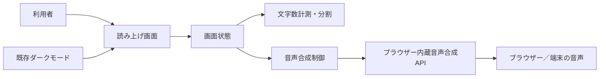

# テキスト読み上げアプリ 設計書

## 1. 文書の目的と状態

この文書は、`docs/要件定義書.md` に基づく設計と実装作業の進捗を管理する。設計時の検討事項と決定内容も記録し、要件・設計・実装間の整合性を保つ。

| 項目 | 状態 |
|---|---|
| 文書状態 | 正式版 |
| 要件定義 | 作成済み |
| 設計上の未決事項 | なし |
| アプリ実装 | 未着手 |

### 1.1 設計の前提

- 要件の正本は `docs/要件定義書.md` とする。要件と本書の記述に差異が生じた場合は、実装を進める前に両文書を整合させる。
- 読み上げはブラウザー内蔵の音声合成機能で行い、アプリから入力テキストをサーバーや外部サービスへ送信しない。
- 入力テキスト、読み上げ位置、音声選択、速度はメモリー上だけで扱う。既存のダークモード設定の保存は維持する。
- 入力テキストを変換・省略しない。文字数制限と分割は、要件で定めた表示文字単位に従う。
- ブラウザーの音声合成APIはクライアント側でのみ利用する。サーバー描画中に `window` や `speechSynthesis` を参照しない。

## 2. 現状と変更対象

現在のトップページはSQLiteからメッセージを取得して表示しており、読み上げ機能は未実装である。既存の `DarkModeProvider` と `Header` は引き継ぎ、読み上げに不要なテンプレート由来のデータベース機能を取り除く。

| 現在の領域 | 設計上の扱い |
|---|---|
| `src/app/page.tsx` | メッセージ取得画面を読み上げ画面へ置き換える |
| `src/app/api/message/route.ts` | 不要。削除対象 |
| `lib/database.ts`、SQLite依存関係 | 不要。削除対象 |
| `src/types/api.ts` | メッセージ画面とAPI専用のため、両者とともに削除 |
| `src/app/components/Header.tsx`、`DarkModeProvider.tsx` | 既存のテーマ切替を維持 |
| README、DB/API関連テスト | 新しいアプリの説明へ更新し、不要なテストを置き換える |

## 3. 論理構成

### 3.1 責務の分割

- **読み上げ画面:** 入力欄、文字数・超過表示、音声選択、速度調整、再生操作、状態・進捗、エラーを表示する。
- **文字列処理:** `Intl.Segmenter` を優先して書記素クラスタを計測し、未対応環境では同じ単位を扱えるフォールバック実装を使う。最大500書記素クラスタの範囲で、文末記号（。！？.!?）または改行のうち最後に現れる位置で分割する。範囲内に分割候補がない場合は500書記素クラスタで分割する。区切り記号は直前のチャンクに含め、分割後のチャンクを連結すると元の入力と完全に一致することを保証する。
- **音声合成制御:** 利用可能音声の取得、既定音声の選択、再生・一時停止・再開・停止、連続チャンク再生、エラー通知、画面破棄時の後始末を担う。
- **テーマ:** 既存の `DarkModeProvider` を維持し、読み上げ機能の状態や設定をテーマ保存領域へ混在させない。

### 3.2 ファイル配置

実装は次の責務分割を基本とし、不要な抽象化や過度なファイル分割は避ける。

| 配置 | 責務 |
|---|---|
| `src/app/page.tsx` | 画面のルート |
| `src/app/components/SpeechReader.tsx` | 読み上げ画面とユーザー操作 |
| `src/lib/speech/text.ts` | 書記素クラスタ計測、チャンク分割 |
| `src/lib/speech/useSpeechSynthesis.ts` | 音声一覧と再生ライフサイクルの管理 |

## 4. 状態と処理フロー

### 4.1 画面が保持する状態

| 状態 | 内容 |
|---|---|
| 入力 | 入力全文と書記素クラスタ数 |
| 音声設定 | 利用可能な日本語音声、選択中の音声、速度（初期値1.0x） |
| 再生 | 状態、読み上げチャンク、現在のチャンク番号（1始まり）と総チャンク数、取得できた場合は現在チャンク内の発話位置 |
| エラー | 利用不可または再生失敗時に利用者へ表示する日本語メッセージ |

これらはReactの画面状態として保持し、ページ再読み込み後に復元しない。

### 4.2 初期化と再生の流れ

1. クライアント側でブラウザーの音声合成機能を確認し、利用可能な日本語音声を取得する。
2. 音声一覧の更新通知にも対応し、一覧を再取得する。日本語音声が後から利用可能になった場合は、既定日本語音声または要件で定めた代替音声を自動選択する。
3. 入力変更時に書記素クラスタ数を再計算する。空入力・空白のみ、10,000文字超過、または音声利用不可の場合は再生を無効にする。
4. 再生時にテキストを最大500書記素クラスタのチャンクへ分割する。各チャンクの範囲内で文末記号（。！？.!?）または改行の最後の位置を優先し、候補がなければ上限で分割する。分割記号はチャンクに保持する。
5. 各チャンクの読み上げ開始時に現在番号／総数（例：2/5）を更新し、画面と支援技術に通知する。一時停止中も現在のチャンク番号を維持する。
6. 一時停止時は現在のチャンクと、発話境界イベントから取得できた最新の `charIndex` を記録する。再開時は有効な `charIndex` があればその位置から現在チャンクを読み直し、取得できなければ現在チャンクの先頭から読み直す。停止時は位置を破棄する。
7. タブ非表示だけでは中断と判定しない。アプリが再生継続を期待しているアクティブ発話に、アプリ自身の停止処理によらないエラーが発生した場合、または表示復帰時に「アプリ状態は再生中」「一時停止要求なし」「APIは `speaking` でも `paused` でもない」「正常終了イベント未受信」のすべてを満たす場合に中断と判定する。中断時は再生状態を中断に更新し、日本語で案内する。ブラウザー／OSによる継続や中断の検出自体は保証しない。
8. 読み上げ中または一時停止中に入力が編集された場合、再生キューを破棄して停止する。新しい内容は再生操作まで読まない。再生失敗時は日本語のエラーを表示し、失敗したチャンク先頭から再試行できるようにする。画面破棄時はイベント購読を解除し、再生を停止する。

## 5. 画面構成とアクセシビリティ

1画面に以下を配置する。

- 複数行テキスト入力欄、文字数、上限超過の案内
- 音声選択と読み上げ速度スライダー
- 再生、一時停止／再開、停止の操作
- 読み上げ状態、進捗、利用不可・エラーの案内
- ブラウザー／端末の音声処理が外部通信を伴う可能性についての説明

操作はキーボードから利用可能にし、操作名・状態・エラー・進捗はスクリーンリーダーにも伝える。既存のレスポンシブレイアウトとライト／ダーク両テーマを維持する。

## 6. データ・外部通信

- 読み上げ本文や設定をAPI、データベース、Cookie、ローカルストレージへ保存しない。
- アプリから音声合成サービスを呼び出さず、ブラウザー内蔵APIだけを使用する。
- ブラウザー／OSが選択音声を端末外で処理するかはアプリから判定・保証しない。その制約を画面上で明示する。
- ダークモード設定の既存保存は維持する。読み上げ設定とは別のデータとして扱う。

## 7. テスト・検証方針

| 対象 | 主な確認内容 |
|---|---|
| 文字列処理の単体テスト | 書記素クラスタ（絵文字・結合文字を含む）、上限境界、文末記号・改行の最後の候補で分割、候補がない場合の上限分割、分割後の文字列一致 |
| 音声制御の単体テスト | 音声なし・非対応、音声一覧の非同期更新、再生／一時停止／再開／停止、境界位置がある場合とない場合の再開、編集時の停止、アクティブ発話のエラー、正常終了・意図的な一時停止と区別した中断検出、後始末 |
| UIテスト | 文字数と上限、ボタンの有効・無効、状態・現在／総チャンク数・エラー・中断案内の表示、キーボード操作、ダークモード |
| CI | `npm run lint`、`npm run build`、`npm test` |
| 実ブラウザー検証 | PCでChrome・Edge・Firefoxの各最新版、iPhone/iPadでSafariの最新版を確認 |
| 性能確認 | 日本語音声が利用可能な状態から最初の音声出力までを代表環境で測定し、2秒以内を目標とする |

音声合成APIの振る舞いは実ブラウザーで確認する。単体テストではAPIをモックし、音声エンジン自体の音質・ネットワーク処理を検証対象にしない。

## 8. 実装進捗

状態は `未着手`、`進行中`、`完了`、`保留` のいずれかに更新する。完了時は確認した受け入れ条件やテストを記録する。

| ID | 作業 | 完了条件 | 依存 | 状態 |
|---|---|---|---|---|
| D-01 | 設計時の検討事項を確定 | 各検討事項の決定を記録し、必要な要件と設計を更新 | — | 完了 |
| I-01 | テンプレートのDB/API機能を除去 | `package.json`／lockfileのSQLite依存、`lib/database.ts`、メッセージAPI、関連テスト・README記述を整理し、既存テーマを維持する。ページとAPI型は変更しない | — | 未着手 |
| I-02 | 文字数計測・長文分割を実装 | 上限とチャンク境界の単体テストを追加 | D-01 | 未着手 |
| I-03 | 音声合成制御を実装 | 音声取得、再生制御、連続読み上げ、エラー・後始末をテスト | D-01、I-02 | 未着手 |
| I-04 | 読み上げ画面を実装 | `src/app/page.tsx`を置き換え、不要となった`src/types/api.ts`と関連ページテストを削除する。入力、設定、操作、状態、進捗、アクセシビリティを実装・テスト | I-01、I-02、I-03 | 未着手 |
| I-05 | ブラウザー・端末検証 | 要件の対象ブラウザーと代表端末で受け入れ条件を確認 | I-04 | 未着手 |

## 9. 設計時の検討事項と決定内容

設計を確定する過程で検討した事項と決定内容を記録する。新たな検討事項が生じた場合は一問ずつ確認し、必要に応じて要件定義書と本書の両方を更新する。

| ID | 検討事項 | 決める内容 | 状態 |
|---|---|---|---|
| Q-01 | 日本語以外の入力 | 入力・読み上げを許可するが、品質は保証しない | 決定済み |
| Q-02 | 停止後の再生 | 停止後に再生したときは入力テキストの先頭から読む | 決定済み |
| Q-03 | 分割に使う句読点 | 文末記号（。！？.!?）と改行を優先し、読点では分割しない | 決定済み |
| Q-04 | 一時停止位置の保証 | 発話境界イベントから有効な `charIndex` を取得できればその位置から現在チャンクを読み直し、取得できなければ現在チャンク先頭から読み直す | 決定済み |
| Q-05 | 進捗表示の精度 | 現在のチャンク番号と総チャンク数を表示する（例：2/5） | 決定済み |
| Q-06 | 読み上げエラー後の再試行 | 失敗したチャンクの先頭から再試行する | 決定済み |
| Q-07 | 再生中の設定変更 | 音声・速度の変更は次回再生から適用し、一時停止からの再開では現在の読み上げ開始時の設定を維持する | 決定済み |
| Q-08 | タブ非表示・画面ロック時 | アクティブ発話のエラー、または表示復帰時に再生中・一時停止要求なし・API停止状態・正常終了イベント未受信がすべて確認できた場合に中断扱い。意図的な一時停止や正常終了は中断としない | 決定済み |
| Q-09 | 音声一覧の非同期取得 | 音声一覧を更新し、日本語音声が後から追加された場合は既定音声を自動選択して再生可能にする | 決定済み |
| Q-10 | 書記素クラスタ計測の代替 | `Intl.Segmenter` を優先し、未対応環境では同じ単位を扱えるフォールバック実装を使う | 決定済み |
| Q-11 | 実機検証の組み合わせ | PCでChrome・Edge・Firefoxの各最新版、iPhone/iPadでSafariの最新版を確認する | 決定済み |

## 10. 変更履歴

| 日付 | 変更内容 |
|---|---|
| 2026-11-25 | 初版の設計書を作成 |
| 2026-11-25 | 検討事項の決定を反映し、正式版として確定 |
